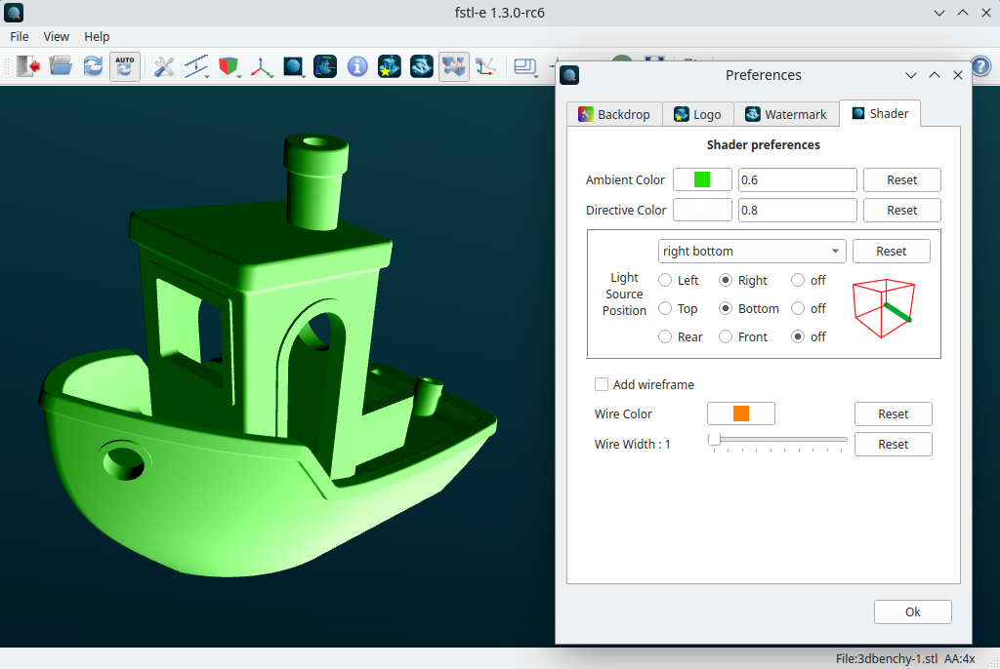
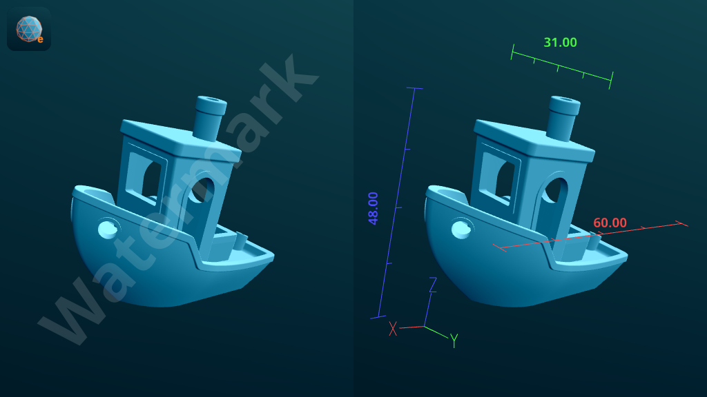
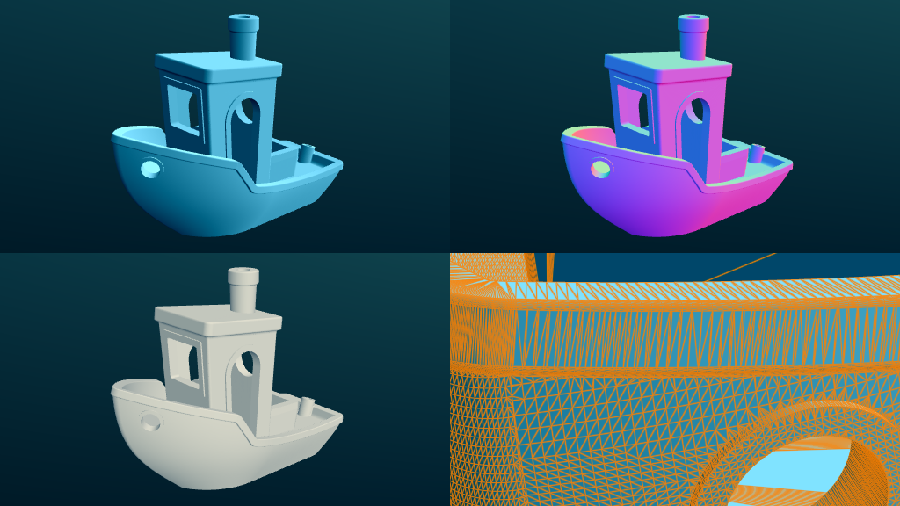
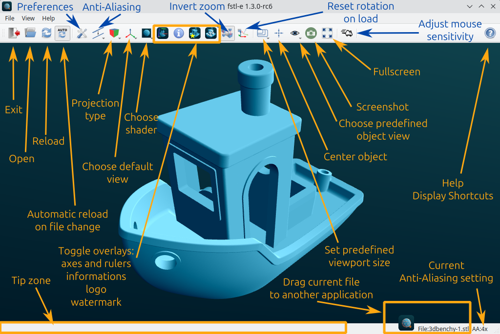

# fstl-e

`fstl-e` is a fork of `fstl` a very fast [.stl file](http://en.wikipedia.org/wiki/STL_\(file_format\)) viewer, available on github at [https://github.com/fstl-app/fstl](https://github.com/fstl-app/fstl). After making some contributions to it, I forked this version which retains `fstl` core functionalities but with some fancy enhancements.

## Screenshots

*Fig 1 : Light source shader configuration*  


*Fig 2 : Add custom logo and watermark - Draw axis and rulers*  


*Fig 3 : Shaders*  

## Changelog
### fstl-e v1.3.0
  * Now runs on both `OpenGL 3.3` and `OpenGL ES 3.0`.
  * Support both `Qt5` and `Qt6`
  * when drawing axes, draw rulers with mesh dimension.
  * draw informations on mesh is now separated from axes
  * add new overlay to draw custom logo
  * add new overlay to draw custom watermark
  * all preferences (background, logo, watermatk and shader) are now grouped in one tabbed dialog.

### fstl-e v1.2.0
  * Add configurable background (new feature by andreasbkrueger)
  * Minor bug correction

### fstl-e v1.1.0
  * Add statusbar with statustip and current file name which can be used to drop the current file to another application like a slicer.
  * Add anti-aliasing functionality
  * Add a menu to choose default rotation between 3 models.
  * Add action to recenter the view.
  * Add menu to choose between predefined views.
  * Add new predefined size HD1080 in viewport size menu.
  * Add popup slider to adjust mouse speed movement.
  * When using open menu, use most recent file's directory.
  * On the command line, can now open a directory.
  * In shader preferences, add a new way of choosing light source position.

## Known Issues

### Wayland
  * The fullscreen function when using `wayland` platform is only activated if `Qt` is at least `6.3.0`. Although it is not guaranteed to work. If you need it you can either :
    * run X11 instead of Wayland
    * set the environment variable `QT_QPA_PLATFORM=xcb`
    * run the program with option `-platform xcb`

## Backend
  * At launch, `fstl-e` will try to use `OpenGL 3.3`, then `OpenGL ES 3.0` and will use the first one available. You can reverse the search order by setting environment variable `FSTLE_GL_BACKEND=es`

## Usage
Usage should be quite straightforward. You may :

  * Use Drag & Drop to drop an `stl` file into `fstl-e` main window.
  * Use desktop integration to open a file
  * Use `File/Open` menu or toolbar `Open` icon
  * on the command line launch `fstl-e myfile.stl` or `fstl-e mydirectory`

Afterwards :

  * Left clic : rotate the object
  * Right clic : translate the object
  * Wheel : zoom in/out
  * You may also drag the file name from the statusbar to another application. (Be carefull though as dropping on the desktop will move the file there).
  * Use Left/Right Arrows to display Previous/Next stl file in directory.


Here's an interface panorama.


*Fig 4 : Interface Panorama*  

### Shortcuts

  * H : Display help message
  * Q : Quit
  * O : Open
  * R : Reload
  * P : Preferences
  * B : Background Settings
  * A : Draw Axes and Rulers
  * I : Draw Infos
  * L : Draw Logo
  * K : Draw Watermark
  * M : Show/Hide Menu (and Toolbar as well)
  * S : Save Screenshot
  * F : Toggle Fullscreen
  * W : Toggle Wireframe on top of shader (if available)
  * C : Center View
  * 0-6 : Apply Default, Top, Bottom, Front, Rear, Left, Right view
  * Left Arrow : load previous stl file
  * Right Arrow : load next stl file
  * Up Arrow : use next shader
  * Down Arrow : use previous shader

## Binary packages
### Latest
  * [fstl-e-v1.3.0](https://github.com/wdaniau/fstl/releases/tag/fstl-e-v1.3.0)

### Previous
  * [fstl-e-v1.2.0](https://github.com/wdaniau/fstl/releases/tag/fstl-e-v1.2.0)
  * [fstl-e-v1.1.0](https://github.com/wdaniau/fstl/releases/tag/fstl-e-v1.1.0)
  * [fstl-e-v1.0.0](https://github.com/wdaniau/fstl/releases/tag/fstl-e-v1.0.0)
  * [fstl-e-release-1](https://github.com/wdaniau/fstl/releases/tag/fstl-e-release-1)


## Build and Install from source

The only dependencies to build for `fstl-e` are [`Qt 5`](https://www.qt.io)(min 5.12) or [`Qt 6`](https://www.qt.io)(min 6.2), [`cmake`](https://cmake.org/) and [`OpenGL/OpenGL ES`](https://www.opengl.org). 

### Linux
```
$ git clone https://github.com/wdaniau/fstl
$ cd fstl
$ mkdir build
$ cd build
$ cmake -DCMAKE_INSTALL_PREFIX:PATH=/some/path ..
$ make
```

Choose `/some/path` according to where you want to install `fstl-e`. By runing `make install`, the following files will be installed :

  * `fstl-e` executable in `/some/path/bin`
  * desktop file in `/some/path/share/applications`
  * icons in `/some/path/share/icons/apps`

Standard choices are :

  * `/usr/local` : this is the default if `-DCMAKE_INSTALL_PREFIX` is omitted. Needs root privileges
  * `/usr` : not a good choice in my opinion as it may interfere with system packages. Needs root privileges
  * `$HOME/.local` : in most modern systems it is a good choice for a user installation as `$HOME/.local/bin` will be in `PATH` variable as well as `$HOME/.local/share` will be in `XDG_DATA_DIRS` variable. Add these if this is not the case.

Note on Qt 5/6 :

`cmake` will try to find `Qt6` then `Qt5`. On a system where you have both, if you want to force `Qt5` use `-DQT_DESIRED_VERSION=5` on the `cmake` command line

#### Create a package using cpack
Alternatively after having run `make`, you can use `cpack` the packaging system integrated with `cmake` to build a package :

  * `cpack -G TGZ` will produce a `.tar.gz` package
  * `cpack -G DEB` will produce a `.deb` package
  * Although not tested as I'm not under a `rpm` distribution, running `cpack -G RPM` should produce a rpm package.


### Windows
I'm mainly a linux user and have very little skill under windows. However I managed to compile `fstl-e` by installing [Visual studio community edition](https://visualstudio.microsoft.com/fr/vs/community/) and [Qt Opensource](https://www.qt.io/download-thank-you?os=windows) and it was quite straightforward using qtcreator on CMakeLists.txt as project. The package installer was build with `cpack` and [nsis](https://nsis.sourceforge.io/Main_Page).


### macOS
I have absolutely no experience under macOS, however this should be possible to compile `fstl-e` by following the instructions on the [fstl github page](https://github.com/fstl-app/fstl).

### Android
There is an [Android port](https://github.com/Prj-m/fstl-e-android) ongoing project.


--------------------------------------------------------------------------------
# fstl License

Copyright (c) 2014-2024 Matthew Keeter

Permission is hereby granted, free of charge, to any person obtaining a copy of this software and associated documentation files (the "Software"), to deal in the Software without restriction, including without limitation the rights to use, copy, modify, merge, publish, distribute, sublicense, and/or sell copies of the Software, and to permit persons to whom the Software is furnished to do so, subject to the following conditions:

The above copyright notice and this permission notice shall be included in all copies or substantial portions of the Software.

THE SOFTWARE IS PROVIDED "AS IS", WITHOUT WARRANTY OF ANY KIND, EXPRESS OR IMPLIED, INCLUDING BUT NOT LIMITED TO THE WARRANTIES OF MERCHANTABILITY, FITNESS FOR A PARTICULAR PURPOSE AND NONINFRINGEMENT. IN NO EVENT SHALL THE AUTHORS OR COPYRIGHT HOLDERS BE LIABLE FOR ANY CLAIM, DAMAGES OR OTHER LIABILITY, WHETHER IN AN ACTION OF CONTRACT, TORT OR OTHERWISE, ARISING FROM, OUT OF OR IN CONNECTION WITH THE SOFTWARE OR THE USE OR OTHER DEALINGS IN THE SOFTWARE.

--------------------------------------------------------------------------------
# fstl-e License

Copyright (c) 2023-2026 William Daniau

Permission is hereby granted, free of charge, to any person obtaining a copy of this software and associated documentation files (the "Software"), to deal in the Software without restriction, including without limitation the rights to use, copy, modify, merge, publish, distribute, sublicense, and/or sell copies of the Software, and to permit persons to whom the Software is furnished to do so, subject to the following conditions:

The above copyright notice and this permission notice shall be included in all copies or substantial portions of the Software.

THE SOFTWARE IS PROVIDED "AS IS", WITHOUT WARRANTY OF ANY KIND, EXPRESS OR IMPLIED, INCLUDING BUT NOT LIMITED TO THE WARRANTIES OF MERCHANTABILITY, FITNESS FOR A PARTICULAR PURPOSE AND NONINFRINGEMENT. IN NO EVENT SHALL THE AUTHORS OR COPYRIGHT HOLDERS BE LIABLE FOR ANY CLAIM, DAMAGES OR OTHER LIABILITY, WHETHER IN AN ACTION OF CONTRACT, TORT OR OTHERWISE, ARISING FROM, OUT OF OR IN CONNECTION WITH THE SOFTWARE OR THE USE OR OTHER DEALINGS IN THE SOFTWARE.
